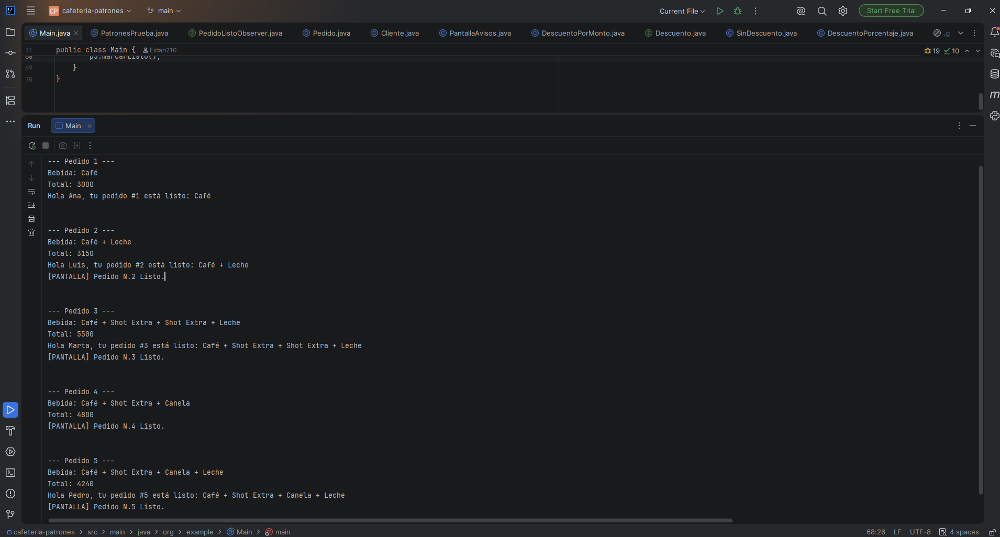

# Cafetería con patrones de diseño en Java

App de consola que modela los pedidos de una cafetería usando tres patrones de diseño: **Decorator** (extras de la bebida), **Strategy** (descuentos) y **Observer** (aviso de pedido listo). Se prueba con 5 pedidos.

## Los tres patrones

### Decorator: extras de la bebida

Una bebida base (`Cafe`) se puede **envolver en capas**, una por cada extra: leche, canela, shot extra. Cada capa cumple la misma interfaz `Bebida`, le pregunta a la bebida que envuelve y suma lo suyo. Así no hace falta una clase por cada combinación de extras.

```java
Bebida b = new Cafe();
b = new Leche(b);
b = new Canela(b);

b.getDescripcion();  // Café + Leche + Canela
b.getPrecio();       // 3000 + 500 + 300 = 3800
```

| Clase | Qué agrega | Precio |
|---|---|---|
| `Cafe` (base) | Café | 3000 |
| `Leche` | + Leche | +500 |
| `Canela` | + Canela | +300 |
| `ShotExtra` | + Shot Extra | +1500 |

Agregar un extra nuevo es crear una clase que extienda `ExtraDecorator`, sin tocar las existentes. Los extras se pueden repetir (por ejemplo, dos shots).

### Strategy: descuentos

Cada forma de calcular el descuento es una clase que implementa la interfaz `Descuento`. El `Pedido` recibe la estrategia y solo le pregunta el resultado, por lo que no tiene ningún `if/else` que decida entre tipos de descuento.

```java
public interface Descuento {
    int aplicar(int total);
}
```

| Estrategia | Regla |
|---|---|
| `SinDescuento` | Se paga el total completo |
| `DescuentoPorcentaje(n)` | Descuenta el n % del total |
| `DescuentoPorMonto(minimo, descuento)` | Si el total llega al mínimo, resta un descuento fijo |

### Observer: aviso de pedido listo

`Pedido` es el sujeto: guarda una lista de observadores y, al llamar `marcarListo()`, les avisa a todos. No conoce a las clases concretas, solo la interfaz `PedidoListoObserver`.

```java
public interface PedidoListoObserver {
    void pedidoListo(Pedido pedido);
}
```

| Observador | Qué hace al recibir el aviso |
|---|---|
| `Cliente` | Saluda al cliente con el número y la descripción de su pedido |
| `PantallaAvisos` | Muestra el número del pedido en la pantalla de la cafetería |

Cada pedido elige a quién avisar: puede tener un cliente, la pantalla, ambos o ninguno.

## Los 5 pedidos de prueba

| # | Bebida | Descuento | Observadores | Total |
|---|---|---|---|---|
| 1 | Café | Sin descuento | Cliente Ana | 3000 |
| 2 | Café + Leche | 10 % | Cliente Luis y pantalla | 3150 |
| 3 | Café + Leche + 2 shots | Por monto (mínimo 5000, descuento 1000) | Cliente Marta y pantalla | 5500 |
| 4 | Café + Canela + Shot | Por monto (mínimo 5000, descuento 1000) | Solo pantalla | 4800 |
| 5 | Café + Leche + Canela + Shot | 20 % | Cliente Pedro y pantalla | 4240 |

Los pedidos 3 y 4 usan la misma estrategia con resultados opuestos: el 3 llega al mínimo y recibe el descuento, y el 4 no.

Salida de la consola:

```
--- Pedido 1 ---
Bebida: Café
Total: 3000
Hola Ana, tu pedido #1 está listo: Café

--- Pedido 2 ---
Bebida: Café + Leche
Total: 3150
Hola Luis, tu pedido #2 está listo: Café + Leche
[PANTALLA] Pedido N.2 Listo.

--- Pedido 3 ---
Bebida: Café + Shot Extra + Shot Extra + Leche
Total: 5500
Hola Marta, tu pedido #3 está listo: Café + Shot Extra + Shot Extra + Leche
[PANTALLA] Pedido N.3 Listo.

--- Pedido 4 ---
Bebida: Café + Shot Extra + Canela
Total: 4800
[PANTALLA] Pedido N.4 Listo.

--- Pedido 5 ---
Bebida: Café + Shot Extra + Canela + Leche
Total: 4240
Hola Pedro, tu pedido #5 está listo: Café + Shot Extra + Canela + Leche
[PANTALLA] Pedido N.5 Listo.
```



## Estructura del proyecto

```
src/main/java/org/example/
├── Main.java                  # Los 5 pedidos de prueba
├── PatronesPrueba.java        # Pruebas por patrón, una por una
├── bebida/                    # Decorator
│   ├── Bebida.java            # Interfaz común
│   ├── Cafe.java              # Bebida base
│   ├── ExtraDecorator.java    # Base de los extras
│   ├── Leche.java
│   ├── Canela.java
│   └── ShotExtra.java
├── descuento/                 # Strategy
│   ├── Descuento.java         # Interfaz
│   ├── SinDescuento.java
│   ├── DescuentoPorcentaje.java
│   └── DescuentoPorMonto.java
├── pedido/                    # Sujeto del Observer
│   ├── Pedido.java
│   └── PedidoListoObserver.java
└── aviso/                     # Observadores concretos
    ├── Cliente.java
    └── PantallaAvisos.java
```

## Cómo ejecutarlo

Requisitos: **Java 21** y **Maven**.

1. Clona el repositorio:
   ```
   git clone https://github.com/Eidan210/cafeteria-patrones.git
   ```
2. Abre el proyecto en IntelliJ IDEA (o cualquier IDE con soporte Maven).
3. Ejecuta `Main` para ver los 5 pedidos, o `PatronesPrueba` para ver cada patrón por separado.

## Qué aprendí

- **Decorator** permite combinar extras sin crear una clase por combinación: cada capa envuelve a otra bebida y suma lo suyo.
- **Strategy** saca el `if/else` de las reglas de descuento: agregar una regla nueva es crear una clase, sin modificar `Pedido`.
- **Observer** deja avisar a varios interesados sin que el sujeto los conozca.
- Los tres patrones se apoyan en lo mismo: programar contra **interfaces** en vez de clases concretas.
- Probar valores en los dos lados de un límite (como el mínimo de `DescuentoPorMonto`) ayuda a detectar errores que el compilador no marca.
